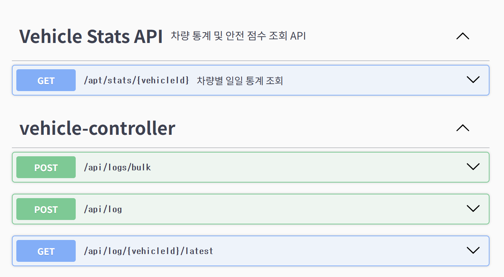
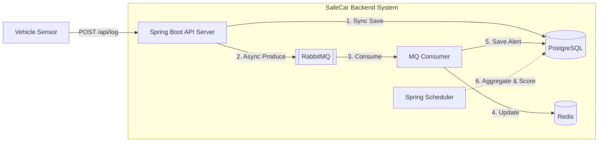
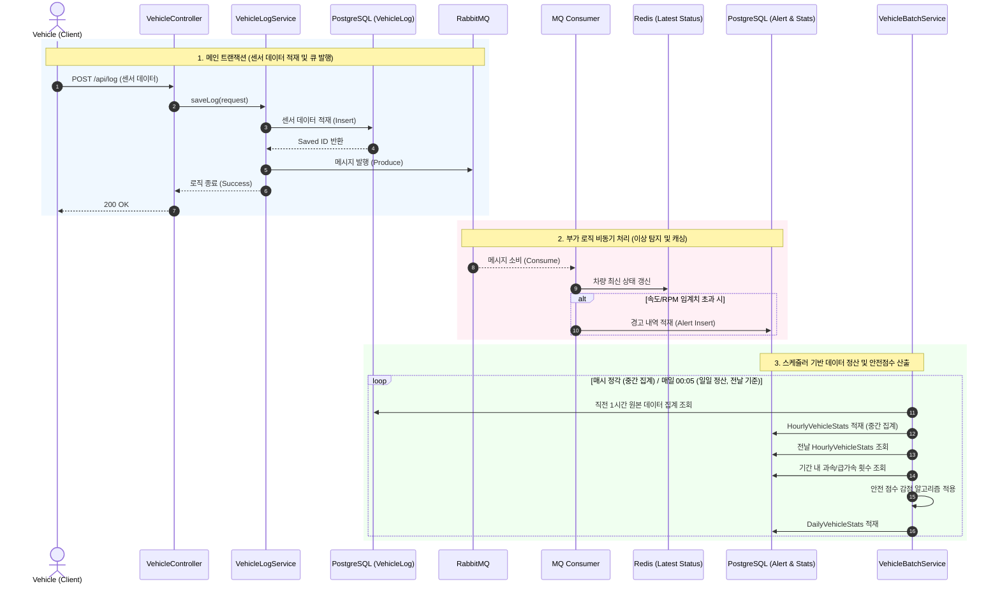

# 🚗 SafeCar: 대규모 모빌리티 센서 데이터 모니터링 시스템

## 🌟 프로젝트 소개
**SafeCar**는 차량에서 1초 단위로 유입되는 센서 데이터(속도, RPM)를 실시간으로 수집하고, 비동기 메시지 큐 파이프라인으로 이상 징후를 탐지해 안전 점수를 산출하는 백엔드 시스템입니다.

단순한 데이터 적재를 넘어, 부가 로직을 메시지 큐로 분리한 구조를 설계하고 **부하 테스트의 결과를 의심하고 재검증하는 데** 집중했습니다. 2월에 "튜닝으로 안 나아져서 하드웨어 한계"라고 내렸던 결론을 8개월 뒤 반복 측정으로 다시 검증해 정정한 과정이 이 프로젝트의 핵심입니다.

| 항목 | 내용 |
| :--- | :--- |
| **개발 기간** | 2026-02 (개인 프로젝트: 설계·구현·1차 부하 테스트) · 2026-09 문서·코드 정리 · 2026-10 부하 테스트 재검증 |
| **담당 범위** | 수집 API, 비동기 파이프라인, 배치 집계, 부하 테스트와 재검증 전 과정 |

---

## 🎯 Key Contributions
* **구조 설계:** 센서 원본 저장은 메인 트랜잭션에, 이상 탐지·Redis 갱신은 RabbitMQ Consumer로 분리 (Spring Event → `@Async` → RabbitMQ로 바꾼 이유를 ADR로 기록)
* **부하 테스트 결과의 재검증:** 같은 설정이 측정 환경에 따라 에러율 0%와 40%대로 갈리는 원인을 가설을 하나씩 기각하며 추적 (창 상태, 부하 생성기의 CPU 점유)
* **요인 분리 실험:** 한꺼번에 바꿨던 스레드·풀·accept-count를 2x2x2 요인 설계로 분리해 상호작용 확인
* **가장 큰 효과를 낸 설정:** `show-sql` 끄기. 5회씩 순서를 섞어 측정해 성공 처리량 약 30% 증가, p95 지연 약 47% 감소 (MQ 도입 전 `@Async` 빌드 기준)

---

## 🛠 기술 스택 (Tech Stack)
* **Language & Framework:** Java 17, Spring Boot 3.0.2, Spring Data JPA
* **Database & Cache:** PostgreSQL, Redis
* **Message Queue:** RabbitMQ
* **Test & Monitoring:** JUnit5, JMeter, 자체 SensorSimulator, Spring Boot Actuator, Prometheus
* **측정 자동화:** PowerShell(실행 큐, CPU 기록), Python(p95 분석)
* **Infra & CI/CD:** Docker, Docker Compose, GitHub Actions

---

## 🚀 주요 기능
| API | Method | Endpoint | Description |
|---|---|---|---|
| 단건 센서 데이터 수집 | POST | `/api/log` | 센서 데이터 저장 후 비동기 처리 파이프라인 시작 (**부하 테스트 대상**) |
| 대량 센서 데이터 수집 | POST | `/api/logs/bulk` | `JdbcTemplate.batchUpdate` 1,000건 단위 저장 + 목록 단위 MQ 발행 |
| 최신 상태 조회 | GET | `/api/log/{vehicleId}/latest` | Redis 기반 최신 운행 상태 조회 |
| 일일 통계·안전 점수 | GET | `/api/stats/{vehicleId}` | 배치로 계산된 일별 통계와 안전 점수 |



---

## 🏗 시스템 아키텍처
1. **수집 (Ingestion):** 차량이 `POST /api/log`로 센서 데이터를 전송
2. **메인 트랜잭션:** 센서 원본을 PostgreSQL에 즉시 저장
3. **MQ 발행:** 같은 트랜잭션 안에서 RabbitMQ로 메시지를 발행해 부가 로직을 요청 스레드에서 분리
4. **소비 (Consumer):** Redis 최신 상태 갱신, 임계치 초과 시 Alert 저장
5. **배치:** 중간 집계(기본 매시 정각)와 일일 정산(기본 매일 00:05, 전날 기준)으로 안전 점수 산출



### 설계 변경 기록 (ADR): Spring Event → RabbitMQ
* **구조 변천:** 2월 19~20일에는 저장·이상 탐지·Redis 갱신이 하나의 요청 흐름에 묶여 있었고, 2월 21일 Spring Event + `@Async`로 분리했습니다. 부하 테스트에서 에러율 52.10%가 나온 구조가 이 `@Async` 방식이며, 이후 RabbitMQ로 교체했습니다.
* **교체 이유:** ① 인메모리 이벤트라 서버가 커밋 직후 죽으면 처리되지 않은 이벤트가 유실됩니다. ② `@EnableAsync` 기본 실행기는 스레드가 8개로 고정이지만 대기열 크기에 제한이 없어, 대량 이벤트가 쏟아지면 처리 못 한 이벤트가 메모리에 쌓일 위험이 있었습니다. RabbitMQ는 큐를 `durable=true`로 선언해 브로커가 재시작돼도 큐가 유지되고, 메시지는 Spring AMQP 기본값(persistent)으로 발행되며, Consumer 동시성·Prefetch를 명시적으로 제한할 수 있습니다. 다만 발행 확인(publisher confirm)은 구현하지 않아 메시지 유실을 완전히 막았다고는 말하지 않습니다.
* **알려진 트레이드오프:** 발행이 DB 커밋 전에 일어나므로, `save()` 이후 커밋 사이에 롤백되면 반영되지 않은 데이터의 메시지가 먼저 나가는 "유령 메시지" 가능성이 이론적으로 남아 있습니다. 발생 확률이 낮고 영향(이상 탐지 1회 공회전)이 작아 Outbox 패턴 대신 트레이드오프로 남겼습니다.



---

## 🔥 부하 테스트 Deep Dive

### 설정과 그 근거
* **현재 설정:** Tomcat 스레드 12, HikariCP 최대 풀 17(코어 8 × 2 + 1), RabbitMQ Consumer 1, Prefetch 10, accept-count 1000, `show-sql` 끔
* **스레드 수의 출처:** 시작값은 공식 N_cpu × U_cpu × (1 + 대기시간/연산시간)으로 잡았습니다(코어 8, 목표 CPU 사용률 0.7, 초기 측정 대기 5ms / 연산 35.68ms → 약 6.4). 이후 풀 17 안에서 API 스레드와 Consumer가 여유를 두도록 **Tomcat 12 + Consumer 1로 나눈 배분값**입니다. 공식이 12를 직접 계산해 준 것이 아닙니다.
* **공식의 한계(재검증에서 확인):** 공식의 W를 무엇으로 정의하느냐에 따라 결과가 달라졌습니다. 커넥션 획득 대기를 W로 보면 N≈7, DB 점유 시간을 W로 보면 30~40(DB가 같은 CPU를 쓰는 환경이라 상한)이었습니다. 정의를 명시하고 DB를 분리한 환경에서 재야 신뢰할 수 있습니다.

### 부하 테스트 결과 (2026-09 재측정)
* 조건: JMeter CLI 모드, ramp-up 5초 / loop 10, `POST /api/log`. 서버와 JMeter를 같은 노트북(8코어)에서 실행했습니다.

| 부하 | 설정 | 에러율 | 성공 요청 처리량 | 평균 응답 시간 |
| :--- | :--- | :--- | :--- | :--- |
| VUSER 5,000 (50,000건, 2회) | Tomcat 12 / Consumer 1 / Prefetch 10 (현재 설정) | 0% / 0% | 1,894/s / 2,066/s | 1.54초 / 1.20초 |
| VUSER 5,000 (50,000건, 2회) | Tomcat 15 / Consumer 2 / Prefetch 10 (비교) | 0.94% / 0.68% | 1,962/s / 1,948/s | 1.46초 / 1.46초 |
| VUSER 2,000 (20,000건, 1회) | Tomcat 12 / Consumer 1 / Prefetch 10 (현재 설정) | 0% | 1,545/s | 0.85초 |

* 실패한 요청은 모두 연결 단계의 거절(`Connection refused`)이었고, 서버 내부 예외(500)와 DB 커넥션 대기 타임아웃은 없었습니다.
* 위 표의 모든 실행에서 성공 응답 수와 DB 저장 행 수가 일치했고, Alert도 요청마다 2건(과속·급가속)씩 저장됐습니다.
* 현재 설정과 비교 설정은 각각 2회씩만 측정한 값이라 **차이를 흔들림과 구분할 수 없어** 어느 쪽이 낫다고 말하지 않습니다(아래 재검증 참조).

### 🔍 재검증 (2026-10): "튜닝으로 안 나아져서 하드웨어 한계"는 근거가 있었나?

**배경:** 2월에는 VUSER 5,000에서 에러율 52.1%가 나왔고, 스레드·Consumer·Prefetch를 바꿔도 내려가지 않자 하드웨어 한계로 결론 내고 VUSER를 2,000으로 낮춰 0%를 확인한 뒤 마쳤습니다. 그러나 당시에는 커넥션 사용량을 확인할 로그가 없었습니다.

**방법:**
* 같은 조건을 반복하고 조건 순서를 섞어서 측정 (조건당 2~5회)
* 숨김 창 + 출력 리다이렉트로 실행하고, 전원 연결·절전 방지·시작 전 안정화를 확인
* 결과를 쓰기 전에 샘플 수·열 수·값 범위를 검증, 본 실험 전 스모크 테스트
* 에러율·성공 처리량·p95 지연·프로세스별 CPU를 함께 기록

**결과:**

| 질문 | 측정 | 결과 |
| :--- | :--- | :--- |
| 2월의 낮은 TPS 사진은? | JMeter Summary Report 재현 | Clear All 하지 않은 누적 표시(총 경과 시간에 대기 시간 포함)일 가능성이 가장 높음 |
| GUI 창 상태가 영향을 주나? | JMeter GUI(리스너 켬), 5000명, 앞에 둠/최소화 각 6회 (동기 Tomcat 7·MQ Tomcat 12 빌드를 합친 값) | **평균 47.0%**(33.8~71.8%) vs **4.7%**(0.8~17.4%), 범위 겹치지 않음 |
| 왜 그런가? | 프로세스별 CPU, 각 3회 | 앞에 둔 JMeter가 CPU **49.8% vs 28.3%**(분석 구간에 따라 약 1.6~1.8배), 앱 22.7% vs 33.6%, 에러율 43.6% vs 8.8%. 화면 그리기 비용의 **간접 증거** |
| CLI는 안전한가? | 시작 방식 2x2, 칸당 4회 | 콘솔 창을 **최소화**해 시작하면 평균 16.8%, **숨김**으로 시작하면 4.9% |
| 병목은? | 프로세스별 CPU | 프로세스별 CPU 합계 87~110%(합산 오차로 100% 초과 가능). 앱은 20~51%, JMeter는 10~55%, PostgreSQL 7~21% |
| 서버가 한계인가? | 포화점, 6000~12000명 | 안정 시행(2회차)에서 에러 2.8~5.0%, 뚜렷한 포화점 없음. 처리량 천장 약 2,500~3,300 req/s |

**설정 효과 (8000명, 요인 설계 2x2x2, 조건당 3회, 24회):**

| 요인 | 에러 평균 | 성공 TPS 평균 | p95 평균 |
| :--- | :--- | :--- | :--- |
| 스레드 7 / 200 | 4.11% / 7.54% | 2,918 / 2,952 | 995 / 1,400 ms |
| 풀 17 / 30 | 4.72% / 6.92% | 2,974 / 2,896 | 1,061 / 1,335 ms |
| accept-count 100 / 1000 | 7.97% / 3.67% | 2,855 / 3,016 | 1,296 / 1,099 ms |

* **accept-count를 1000으로 맞춘 조건에서는 스레드·풀 조합 간 뚜렷한 차이가 관찰되지 않았습니다**(에러 3.2~4.3%). accept가 100일 때만 조합 차이(1.6~13.4%)가 났고, 스레드 200·풀 30이 나쁜 경향이었습니다. accept를 키우면 연결 거절이 줄어(12회 합계 76,482건 → 35,163건) 차이가 가려졌을 가능성이 있으며, 상호작용으로 보입니다. 다만 accept 1000에서 p95가 더 길어지지는 않아 거절이 대기로 바뀌었다고까지는 말하지 않습니다.
* 처리량 천장은 어떤 조합도 올리지 못했습니다.

**`show-sql` 켜기/끄기 (MQ 도입 전 `@Async` 빌드 `fae13e0`, Tomcat 7, VUSER 5,000, 각 5회, 순서를 섞어 측정):**

| | 성공 TPS 평균 | p95 평균 | 에러율 중앙값 |
| :--- | :--- | :--- | :--- |
| 끔 | 2,827/s | 1,029 ms | 2.57% |
| 켬 | 2,171/s (끈 쪽 대비 -23%) | 1,935 ms (끈 쪽 대비 1.9배) | 1.21% |

켠 쪽 5회가 모두 끈 쪽 5회보다 느려 범위가 겹치지 않았습니다. 켠 상태를 기준으로 끄면 성공 TPS가 약 30% 늘고(2,171 → 2,827) p95가 약 47% 줄었습니다(1,935 → 1,029 ms). RabbitMQ 도입 이후 빌드에서도 같은 개선율이 나온다고 말하지는 않습니다. 에러율은 켠 쪽이 오히려 낮았는데, 처리 속도가 느려져 순간 거절이 줄었을 가능성이 있어 에러율만으로는 판단할 수 없습니다.

**결론:**
* 2월의 높은 에러율과 낮은 TPS는 서버 설정이나 하드웨어 한계보다, **한 노트북에서 부하 생성기가 CPU를 나눠 쓰는 측정 환경**의 영향일 가능성이 큽니다. 단, 2월 당시 창 상태와 쉬는 시간은 알 수 없어 "가능성"까지만 말합니다.
* 스레드·풀·Consumer·Prefetch 튜닝의 효과는 이 환경에서 **검출되지 않았습니다**("효과 없음"이 아니라 "검출되지 않음"). 에러가 이미 0~2%인 구간(바닥 효과)이거나 accept 설정에 가려졌을 가능성이 있습니다.
* 가장 분명한 개선은 불필요한 로그 출력(`show-sql`)을 끄는 것이었습니다(위 빌드 기준).

### 측정 조건과 한계
| 항목 | 내용 |
| :--- | :--- |
| 환경 | Windows 11, 8코어 노트북 한 대에 JMeter·앱·PostgreSQL·Docker(RabbitMQ, Redis) 공존 |
| 부하 | `POST /api/log`, ramp-up 5초, loop 10 (사용자 수 x 10건) |
| 측정 횟수 | 조건당 2~5회 (포화점 2회, 2x2x2는 조건당 3회로, 같은 조건 안 범위가 5~25%로 커서 "최고 조합"은 경향으로만 말함) |
| 측정 시점 | 낮과 저녁의 처리량 천장이 달랐음(2,500~2,900 vs 3,000~3,300). 절대값보다 같은 시간대 비교가 의미 있음 |
| 재현성 | 측정 스크립트·분석 스크립트·요약 CSV는 [`loadtest-retest/`](loadtest-retest/README.md)에 포함 (원본 결과 파일과 jar는 제외) |
| 일반화 | 이 환경의 결과이며 "MQ가 성능을 올렸다", "7이 최적이다"로 일반화하지 않음 |

상세 수치와 실험 이력은 [재검증 문서](docs/부하테스트_재현.md)와 [실험 이력과 회고](docs/실험_이력과_회고.md)에 있습니다.

---

## 📊 중간 집계(Rolling Aggregation) 배치
* **문제 상황:** 하루치 센서 데이터를 자정에 한 번에 정산하면 RDBMS Lock과 메모리 과부하 위험이 있습니다.
* **구현:** 중간 집계가 구간별 평균·최고 속도·건수를 `HourlyVehicleStats`에 적재하고, 일일 정산은 원본 로그 대신 이 요약 테이블을 읽어 건수로 가중한 하루 평균과 안전 점수를 계산합니다. 같은 차량·날짜를 다시 정산하면 기존 행을 갱신합니다. 주기와 구간은 `application.properties`의 `batch.*`로 조정합니다(기본: 중간 집계 매시 정각 / 일일 정산 매일 00:05, 전날 기준).
* **효과는 측정하지 않았습니다.**
* **변경 시점:** 2026년 2월 구현은 기능 확인용으로 중간 집계를 매분, 일일 정산을 매시 정각에 실행했고 일일 정산은 원본 로그를 직접 집계했습니다. 요약 테이블 조회와 설정 가능한 주기는 2026-09-30에 추가했습니다.

---

## 🧪 CI/CD 및 실행 방법
GitHub Actions로 `main` push·PR마다 JDK 17 환경에서 테스트와 빌드를 수행합니다.

```bash
# 1. 클론
$ git clone https://github.com/dev-chanyoung/SensorDetectionSystem.git
$ cd SensorDetectionSystem

# 2. 인프라(PostgreSQL, Redis, RabbitMQ) 실행
$ docker-compose up -d postgres redis rabbitmq

# 3. 실행
$ ./gradlew bootRun
```
API 문서는 서버 실행 후 `http://localhost:8080/swagger-ui/index.html`에서 확인합니다.

---

## 💡 회고 및 배운 점 (Retrospective)

**"설정값을 근거로 정했다고 믿었지만, 결과는 같은 조건에서 반복해야 믿을 수 있었다"**

2월에는 설정을 바꿔도 에러율이 내려가지 않자 서둘러 하드웨어 한계로 결론 냈습니다. 8개월 뒤 반복 측정을 해 보니 같은 서버 설정이 측정 시점과 환경에 따라 0%와 40%대로 갈렸고, JMeter GUI는 창 상태 하나만으로도 평균 에러율이 4.7%와 47.0%로 달랐습니다(동기·MQ 빌드를 합친 값). 부하를 만드는 JMeter가 서버와 같은 CPU를 나눠 쓰고 있었기 때문에, 서버만의 한계라고 단정할 수 없었습니다.

배운 것은 다섯 가지입니다.
1. 에러율이 낮아졌다는 사실과 원인을 해결했다는 판단을 구분한다.
2. 측정 도구가 서버 자원을 뺏을 수 있으니 부하 생성 환경까지 의심한다.
3. 설정은 한 번에 하나씩(또는 요인 설계로) 바꿔야 원인이 분리된다.
4. "효과 없음"과 "효과가 검출되지 않음"을 구분한다. 에러가 이미 낮은 구간에서는 튜닝 효과가 보이지 않는다.
5. 지표의 정의(공식의 W, p95가 성공 요청만인지)를 명시한다.

AI 코드 리뷰와 AI의 해석도 그대로 받아들이지 않고 커밋 이력과 측정 기록으로 대조해 정정했습니다.

---

## 🔭 향후 개선
* 부하 생성기와 서버를 다른 PC로 분리해 처리량 천장이 서버의 한계인지 확인
* DB를 분리한 환경에서 C/W를 다시 재고, W를 DB 응답 대기로 정의해 스레드 수 계산
* 스레드 7·풀 17·accept 100 조합이 실제로 가장 나은지 5회 이상으로 확인 (2x2x2의 경향 확정)
* JMeter GUI에서 리스너를 끄고 비교해 화면 그리기 비용 확정
* Transactional Outbox로 발행 시점 문제 해결
